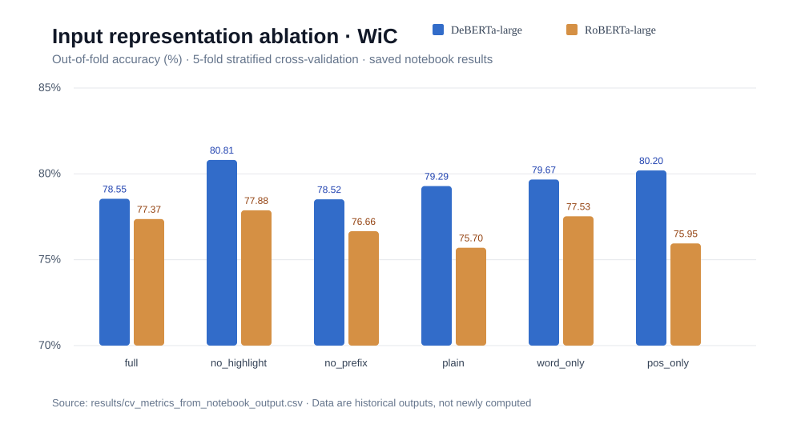

# Word-in-Context — Studio delle rappresentazioni di input

**Python · NLP · Transformers · DeBERTa-large · RoBERTa-large**

Questo repository raccoglie il notebook che ho usato per studiare l'effetto della rappresentazione dell'input sul task Word-in-Context. Il problema è capire se la stessa parola viene usata con lo stesso significato in due frasi. Invece di modificare l'architettura, ho provato a cambiare il modo in cui le frasi vengono passate al modello.



## Esperimenti

Le condizioni principali sono quattro: `full` (marker e prefisso), `no_highlight` (solo prefisso), `no_prefix` (solo marker) e `plain` (nessuno dei due). Ho considerato due backbone, DeBERTa-large e RoBERTa-large, prima con tre seed sul validation set fisso e successivamente con **5-fold cross-validation su 6.066 esempi**. Sono presenti anche le condizioni `word_only` e `pos_only`.

Non mi sono limitato all'accuracy: nel notebook ho raccolto le predizioni OOF, calcolato macro-F1, utilizzato il test di McNemar con correzione di Holm e intervalli bootstrap, e analizzato alcune differenze tra gli errori.

## Il risultato che mi interessava

| Condizione | DeBERTa-large | RoBERTa-large |
| --- | ---: | ---: |
| `full` | 78,55% | 77,37% |
| `no_highlight` | **80,81%** | **77,88%** |
| `no_prefix` | 78,52% | 76,66% |
| `plain` | 79,29% | 75,70% |

Con DeBERTa-large, eliminare i marker dalla condizione `full` porta a **+2,26 punti percentuali** di accuracy OOF. Nel confronto del notebook la differenza è significativa dopo la correzione di Holm. Non ottengo la stessa evidenza statistica per il confronto corrispondente su RoBERTa-large.

Questi numeri sono tratti dagli output salvati nel notebook, **non da una nuova esecuzione**.

## Dove guardare

- [`notebooks/wic_ablation_study.ipynb`](notebooks/wic_ablation_study.ipynb): notebook principale con codice e appunti personali sui passaggi più tecnici.
- [`archive/wic_research_notebook_with_study_notes.ipynb`](archive/wic_research_notebook_with_study_notes.ipynb): versione integrale con tutte le celle del notebook originale, comprese quelle vuote.
- [`results/`](results/): risultati trascritti dagli output salvati.
- [`train_cv_new_models.py`](train_cv_new_models.py): script locale che ripete la stessa k-fold CV del notebook su altri backbone.
- [`docs/methodology.md`](docs/methodology.md) e [`docs/running_the_notebook.md`](docs/running_the_notebook.md): metodologia, limiti e istruzioni.

## Estensione: altri backbone (script di training locale)

[`train_cv_new_models.py`](train_cv_new_models.py) riproduce la **stessa 5-fold CV stratificata** della sezione 8 del notebook (stesso pool train+dev da 6.066 esempi, stesso seed 1234, stesse sei condizioni, stessi iperparametri, stesso seed per fold) su sette backbone aggiuntivi: NomicBERT, UltraBERT, Ettin, EuroBERT, NeoBERT, mmBERT e ModernBERT. Rispetto al notebook cambia solo la lista dei modelli.

Lo script è ottimizzato per Apple Silicon (MPS): FP32, batch effettivo 16 (stessi passi ottimizzatore del 4×4 del notebook) ed è **riprendibile**: le predizioni OOF vengono salvate dopo ogni fold in `results/extra_models/cv/cv_oof_preds.json`.

**Due ambienti, un unico file di risultati.** I backbone custom-code si dividono per versione di transformers: NomicBERT richiede la **v4** (il suo codice usa API rimosse in v5), UltraBERT è nativo **v5**. Il run si divide quindi in due, sullo stesso file OOF (protocollo e seed identici in ogni caso):

```bash
# Ambiente 1: transformers 4.x — NomicBERT, Ettin, EuroBERT, NeoBERT, mmBERT, ModernBERT
uv venv .venv && uv pip install -r requirements.txt
.venv/bin/python train_cv_new_models.py --backbone nomic-ai/nomic-bert-2048 jhu-clsp/ettin-encoder-150m EuroBERT/EuroBERT-210m chandar-lab/NeoBERT jhu-clsp/mmBERT-base answerdotai/ModernBERT-base

# Ambiente 2: transformers 5.x — solo UltraBERT
uv venv .venv-v5 && uv pip install -r requirements.txt && uv pip install 'transformers>=5'
.venv-v5/bin/python train_cv_new_models.py --backbone dmis-lab/UltraBERT-150M

# Flag utili (in entrambi gli ambienti)
.venv/bin/python train_cv_new_models.py --folds 0     # test/benchmark rapido (1 fold)
.venv/bin/python train_cv_new_models.py --stats-only  # tabelle dai risultati salvati
```

Nota: il codice custom di NeoBERT importa `xformers` (solo CUDA, non disponibile su macOS); nel repository c'è uno stub `SwiGLU` in torch puro in `vendor/xformers/` (matematica identica, compatibile con i checkpoint) che lo script aggiunge a `sys.path` come fallback.

**Watchdog GPU (Apple Silicon):** i run MPS lunghi possono essere interrotti dal watchdog GPU di
macOS (`MPS command buffer execution failed: Impacting Interactivity`), soprattutto con display
acceso e GPU satura. Lo script imposta automaticamente `AGX_RELAX_CDM_CTXSTORE_TIMEOUT=1` e,
poiché il run è riprendibile dopo ogni fold, in caso di crash basta rilanciare lo stesso comando
(i fold completati vengono saltati). Nei run non presidiati, far andare in sleep il display riduce
ulteriormente il rischio.

Output: `results/extra_models/cv/cv_ablation_summary.csv` (accuracy/F1 OOF per condizione), `cv_mcnemar_bootstrap.csv` (McNemar + Holm + CI bootstrap) e tabelle LaTeX stampate nel log. Se il run si interrompe, basta rilanciarlo: i fold già completati vengono saltati.

## Cosa non considero ancora risolto

Nel codice della cross-validation seleziono il checkpoint usando il fold sul quale misuro anche le prestazioni. Questa scelta può dare stime ottimistiche; per una valutazione indipendente userei una validation interna al training fold. Un altro limite è il campo POS: il loader imposta `N` come default e gli output mostrano `N` per tutti gli esempi. La condizione `pos_only` diventa quindi un prefisso costante, non un vero confronto fra categorie grammaticali.

Il notebook è pensato per **Google Colab con GPU e Google Drive**. Gli addestramenti e i checkpoint non sono inclusi nel repository; il dataset viene scaricato dal link pubblico presente nel codice. Le celle non vuote del notebook principale mantengono il **codice originale identico**, mentre la versione integrale è conservata in `archive/`.

Lavoro collegato: *Optimizing Input Representations for Word-in-Context: A Controlled Ablation Study* (AIxIA 2026), con Claudio Daloiso, Francesca Fallucchi, Manuel Gozzi e Andrea Ligi. Questo repository raccoglie notebook e appunti, non sostituisce l'articolo scientifico.

[English version](README.md)