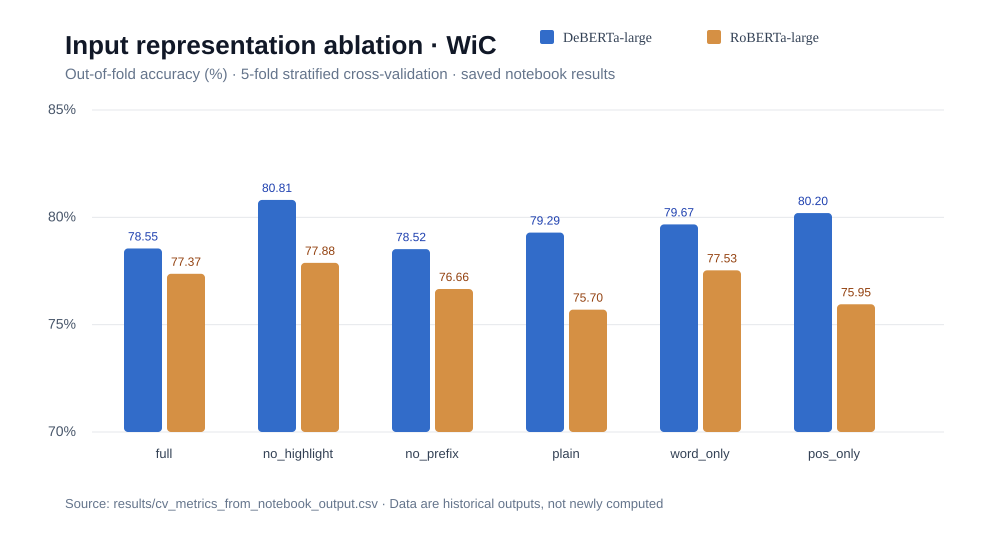

# Word-in-Context — Input Representation Ablation

*A research notebook and a record of the experiments behind an NLP ablation study.*

**Python · PyTorch · Hugging Face Transformers · DeBERTa · RoBERTa · Statistical testing**

I worked on a fairly specific question: **does the way we format the input change a language model's ability to distinguish word meanings in context?** Instead of introducing a new architecture, I compared representations of the same sentence pairs on the Word-in-Context (WiC) task.

This repository contains the experimental notebook, the analysis notes I used while working through the pipeline, and a small set of results extracted from its saved outputs. The code was developed for **Google Colab with Google Drive storage**.



## What I tested

WiC asks whether a target word has the same meaning in two sentences. I tested two pretrained backbones — `microsoft/deberta-large` and `roberta-large` — across four main input formats:

| Configuration | Target markers | Word/POS prefix |
| --- | :---: | :---: |
| `full` | Yes | Yes |
| `no_highlight` | No | Yes |
| `no_prefix` | Yes | No |
| `plain` | No | No |

The additional `word_only` and `pos_only` settings were used to explore the contribution of the prefix. I used an initial fixed-validation experiment with three random seeds, followed by a **5-fold stratified cross-validation** on **6,066 labeled examples**. The notebook includes out-of-fold (OOF) predictions, accuracy, macro-F1, McNemar tests, Holm correction, bootstrap confidence intervals, and an error analysis.

## Results recorded in the notebook

These are **OOF accuracies from the saved notebook output**, not results from a new execution in this repository.

| Input | DeBERTa-large | RoBERTa-large |
| --- | ---: | ---: |
| `full` | 78.55% | 77.37% |
| `no_highlight` | **80.81%** | **77.88%** |
| `no_prefix` | 78.52% | 76.66% |
| `plain` | 79.29% | 75.70% |

For DeBERTa-large, removing the target markers from `full` improved the OOF accuracy by **2.26 percentage points**. In the notebook's paired McNemar analysis, the comparison is significant after Holm correction (reported `p_Holm < 0.001`). For RoBERTa-large, the corresponding increase is **0.51 pp**, and that contrast is **not significant** after correction.

The remaining six-condition results are in [`results/cv_metrics_from_notebook_output.csv`](results/cv_metrics_from_notebook_output.csv). The statistical output is preserved in [`results/statistics_from_notebook_output.txt`](results/statistics_from_notebook_output.txt).

## Repository contents

```text
notebooks/
  wic_ablation_study.ipynb               # Main notebook, with learning/research notes
archive/
  wic_research_notebook_with_study_notes.ipynb  # All original cells, including empty ones
assets/
  cv_accuracy.svg                        # Chart based on the saved result metrics
results/
  cv_metrics_from_notebook_output.csv    # Values extracted from saved output
  statistics_from_notebook_output.txt
docs/
  methodology.md                         # Experiment design and limitations
  running_the_notebook.md                # How to run it on Colab
train_cv_new_models.py                   # Local k-fold CV script for extra backbones
```

The **non-empty code cells in the main notebook have exactly the same source and order as the original notebook**, and their original saved outputs are preserved. Only empty code cells were omitted for readability; markdown notes and notebook-level presentation metadata were adjusted. The archived notebook retains all original code cells and outputs, including the empty cells.

## Running the experiments

1. Open [`notebooks/wic_ablation_study.ipynb`](notebooks/wic_ablation_study.ipynb) in Google Colab and select a GPU runtime.
2. Run the installation and setup cells in order. The notebook downloads the public WiC dataset from the URL included in its code.
3. Authorize the Google Drive mount. Results, OOF predictions, checkpoints and figures are written to `MyDrive/wic_paper/`.
4. Run the training/CV sections only if you have the hardware and time required. The saved run uses 2 large backbones, 6 CV conditions and 5 folds (60 CV runs); model checkpoints and Drive result files are **not included** in this repository.

The notebook was developed with Colab-specific assumptions. `requirements.txt` lists the main dependencies but **is not a verified environment lockfile**. Detailed instructions: [`docs/running_the_notebook.md`](docs/running_the_notebook.md).

## Extended ablation: extra backbones (local training script)

[`train_cv_new_models.py`](train_cv_new_models.py) runs the **same 5-fold stratified CV** as notebook section 8 (same WiC train+dev pool of 6,066 examples, same split seed 1234, same six conditions, same Optuna hyperparameters, same per-fold seeds) on seven additional backbones: NomicBERT (`nomic-ai/nomic-bert-2048`), UltraBERT (`dmis-lab/UltraBERT-150M`), Ettin (`jhu-clsp/ettin-encoder-150m`), EuroBERT (`EuroBERT/EuroBERT-210m`), NeoBERT (`chandar-lab/NeoBERT`), mmBERT (`jhu-clsp/mmBERT-base`), ModernBERT (`answerdotai/ModernBERT-base`). Only the model list differs from the notebook.

It is tuned for Apple Silicon (MPS): FP32, effective batch 16 (identical optimizer steps to the notebook's 4×4), resumable run (OOF predictions are saved after every fold in `results/extra_models/cv/cv_oof_preds.json`).

**Two environments, one results file.** The custom-code backbones split across transformers versions: NomicBERT needs **v4** (its code uses APIs removed in v5), while UltraBERT is **v5-native**. So the run is split in two, sharing the same OOF file (identical protocol/seeds either way):

```bash
# Environment 1: transformers 4.x — NomicBERT, Ettin, EuroBERT, NeoBERT, mmBERT, ModernBERT
uv venv .venv && uv pip install -r requirements.txt
.venv/bin/python train_cv_new_models.py --backbone nomic-ai/nomic-bert-2048 jhu-clsp/ettin-encoder-150m EuroBERT/EuroBERT-210m chandar-lab/NeoBERT jhu-clsp/mmBERT-base answerdotai/ModernBERT-base

# Environment 2: transformers 5.x — UltraBERT only
uv venv .venv-v5 && uv pip install -r requirements.txt && uv pip install 'transformers>=5'
.venv-v5/bin/python train_cv_new_models.py --backbone dmis-lab/UltraBERT-150M

# Useful flags (both environments)
.venv/bin/python train_cv_new_models.py --folds 0     # quick sanity/benchmark (1 fold)
.venv/bin/python train_cv_new_models.py --stats-only  # tables from saved OOF predictions
```

Note: NeoBERT's custom code imports `xformers` (CUDA-only, not available on macOS); the repo ships a minimal pure-torch `SwiGLU` stub in `vendor/xformers/` (mathematically identical, checkpoint-compatible) that the script puts on `sys.path` as a fallback.

**GPU watchdog (Apple Silicon):** long MPS runs can be killed by the macOS GPU watchdog
(`MPS command buffer execution failed: Impacting Interactivity`), especially with the display on
and the GPU saturated. The script sets `AGX_RELAX_CDM_CTXSTORE_TIMEOUT=1` automatically, and since
the run is resumable after every fold, if it crashes you just relaunch the same command (completed
folds are skipped). For unattended runs, letting the display sleep reduces the risk further.

Outputs: `results/extra_models/cv/cv_ablation_summary.csv` (per-condition OOF accuracy/F1), `cv_mcnemar_bootstrap.csv` (McNemar + Holm + bootstrap CIs), plus LaTeX tables printed to the log. If the run is interrupted, just re-launch it: completed folds are skipped.

## Limitations I would address next

- **Checkpoint selection:** during CV, the same fold is used for model evaluation and for selecting the best checkpoint (`load_best_model_at_end=True`). This makes the reported OOF accuracy potentially optimistic. A separate validation split *within each training fold* is needed for a strictly independent estimate.
- **POS field:** the JSON loader falls back to `N` for missing `pos`, and the notebook outputs show `N` for every example. Therefore `pos_only` behaves as a **constant prefix**, not as an evaluation of varying part-of-speech labels. I would fix the POS annotation before drawing conclusions about grammatical categories.
- **Reproduction:** saved outputs were recovered from Drive; source checkpoints and original OOF JSON files are not tracked here. Results can be inspected, but full numerical reproduction was **not tested** while preparing the public repository.
- **Exploratory plotting:** some later figures use hard-coded values from previously generated tables; these should be regenerated from exported CSVs when updating results.

I kept these points visible because interpreting an experiment also means checking what the results **do not** establish. See [`docs/methodology.md`](docs/methodology.md).

## Research context and attribution

Related study: *Optimizing Input Representations for Word-in-Context: A Controlled Ablation Study* (AIxIA 2026), with Claudio Daloiso, Francesca Fallucchi, Manuel Gozzi and Andrea Ligi. This repository presents the notebook and accompanying study notes; it is not a complete research artifact or a replacement for the paper.

Dataset: Word-in-Context (WiC), as distributed within SuperGLUE. Please consult the dataset's original terms and citation requirements. Model weights, training data and private Google Drive artifacts are not redistributed here.

An Italian project description is available in [`README.it.md`](README.it.md).